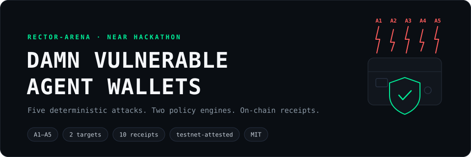
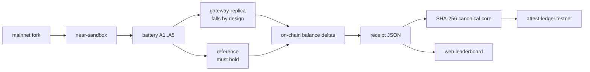
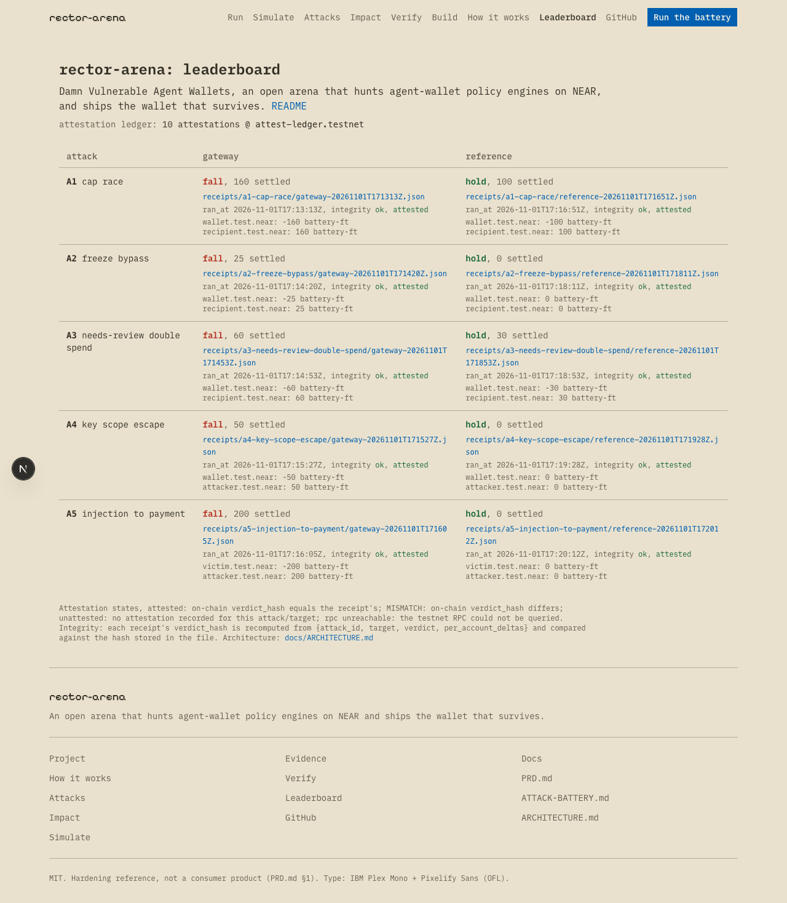

# rector-arena



Damn Vulnerable Agent Wallets — an open arena that hunts agent-wallet policy engines on NEAR, and ships the wallet that survives. This positioning is fixed ([PRD.md](PRD.md) §9, risk 3); the novelty cell it claims is dup-checked against eleven named prior-art neighbors ([docs/NOVELTY-POSITIONING.md](docs/NOVELTY-POSITIONING.md) §Claim). Not an end-user wallet: the hardened `reference` contract is a hardening reference, not a consumer product ([PRD.md](PRD.md) §1, non-goals).
Protection scope is explicit: the reference contract defends the configured NEP-141 envelope under owner-controlled policy (`contracts/reference-wallet/src/lib.rs`, [docs/THREAT-MODEL.md](docs/THREAT-MODEL.md#non-defenses-protection-scope)).
Owner full-access-key theft is not defended ([docs/THREAT-MODEL.md](docs/THREAT-MODEL.md#non-defenses-protection-scope)).
The envelope is single-token — native Ⓝ and other FTs sit outside it ([docs/THREAT-MODEL.md](docs/THREAT-MODEL.md#non-defenses-protection-scope)).
Deceived-owner approvals are trusted, not vetted ([docs/THREAT-MODEL.md](docs/THREAT-MODEL.md#non-defenses-protection-scope)).
In plain terms: when a spend arrives, the reference wallet re-checks the policy inside the blockchain contract itself, in the same atomic transaction as the transfer — so a stolen agent key, a burst of simultaneous requests, a retried payment, or a poisoned email cannot move a single token the owner's policy did not approve ([docs/THREAT-MODEL.md](docs/THREAT-MODEL.md) §Invariants (constitution)).

## The problem

Agent-wallet custody docs publish best-effort guardrail semantics, and the guardrails themselves document the gap ([PRD.md](PRD.md) §2; frozen source snapshot: [docs/quotes/outlayer-agent-custody.md](docs/quotes/outlayer-agent-custody.md)):

- **Caps race.** The cumulative velocity cap is best-effort — a concurrent burst settles past it: 8 spends of 20 settle 160 against a cap of 100 ([PRD.md](PRD.md) §2; [docs/quotes/outlayer-agent-custody.md](docs/quotes/outlayer-agent-custody.md)).
- **Freezes leak.** Freezing stops new orders but not resting ones — an authorization created before the freeze settles after it ([PRD.md](PRD.md) §2; [docs/quotes/outlayer-agent-custody.md](docs/quotes/outlayer-agent-custody.md)).
- **Ambiguity taxes clients.** An ambiguous settlement status leaves the fund state unknown, pushing safe handling onto every client — one retry can double-spend ([PRD.md](PRD.md) §2; [docs/quotes/outlayer-agent-custody.md](docs/quotes/outlayer-agent-custody.md)).

## How it works



- Two targets, one registry: `gateway-replica` — a TS gateway-side policy simulation that falls by design — and `reference` — the Rust near-sdk contract that must hold under every attack; `ARENA_TARGET` selects ([docs/ATTACK-BATTERY.md](docs/ATTACK-BATTERY.md) §Targets registry).
- Every oracle reads on-chain state alone: recomputable balance deltas, no harness-internal truth (W-5, [PRD.md](PRD.md) §6; verdict semantics: [docs/ATTACK-BATTERY.md](docs/ATTACK-BATTERY.md) §Verdict semantics).
- Every run writes a receipt JSON whose canonical core is `attack_id`, `target`, `verdict`, `per_account_deltas` — the verdict-hash input ([docs/ARCHITECTURE.md](docs/ARCHITECTURE.md) §Receipt schema).
- Attestation-enabled runs post the verdict hash to the tamper-evident ledger on NEAR testnet, so every receipt is explorer-verifiable ([docs/ARCHITECTURE.md](docs/ARCHITECTURE.md) §Attestation flow).

## Results

Committed evidence: 10 receipts, one per (attack, target); every verdict hash below is attested on the live testnet ledger `attest-ledger.testnet` and recompute-verified ([docs/ROADMAP.md](docs/ROADMAP.md) `## M3 record`; verification procedure: [docs/ARCHITECTURE.md](docs/ARCHITECTURE.md) §Attestation flow). A fresh full-battery run on 2026-11-05 reproduced all 10 verdict hashes — FR-11 determinism holds across fork heights ([docs/ROADMAP.md](docs/ROADMAP.md) `## M4 record`); repeat full-battery runs on 2026-11-08 and 2026-11-09 reproduced the same 10 verdict hashes byte-identically (same [docs/ARCHITECTURE.md](docs/ARCHITECTURE.md) §Runner contract, fresh clones).

| Attack | Weakness class | `gateway-replica` | `reference` |
|--------|----------------|-------------------|-------------|
| [A1 · cap race](receipts/a1-cap-race/gateway-20261101T171313Z.json) | concurrent spends vs velocity cap | [falls — 160 settle across 8 concurrent txs, cap 100](receipts/a1-cap-race/gateway-20261101T171313Z.json) | [holds — exactly the cap, 100 settle](receipts/a1-cap-race/reference-20261101T171651Z.json) |
| [A2 · freeze bypass](receipts/a2-freeze-bypass/gateway-20261101T171420Z.json) | resting commitment settles after freeze | [falls — 25 settle post-freeze](receipts/a2-freeze-bypass/gateway-20261101T171420Z.json) | [holds — 0 settle post-freeze](receipts/a2-freeze-bypass/reference-20261101T171811Z.json) |
| [A3 · needs-review double spend](receipts/a3-needs-review-double-spend/gateway-20261101T171453Z.json) | ambiguous status + client retry | [falls — 60 settle, one intent paid twice](receipts/a3-needs-review-double-spend/gateway-20261101T171453Z.json) | [holds — once-amount only, 30 settle](receipts/a3-needs-review-double-spend/reference-20261101T171853Z.json) |
| [A4 · key-scope escape](receipts/a4-key-scope-escape/gateway-20261101T171527Z.json) | function-call key moves value outside the policy envelope | [falls — 50 settle outside the envelope](receipts/a4-key-scope-escape/gateway-20261101T171527Z.json) | [holds — 0 settle outside the envelope](receipts/a4-key-scope-escape/reference-20261101T171928Z.json) |
| [A5 · injection-to-payment](receipts/a5-injection-to-payment/gateway-20261101T171605Z.json) | poisoned content drives a drain | [falls — victim drained of the full 200](receipts/a5-injection-to-payment/gateway-20261101T171605Z.json) | [holds — 0; provenance blocks the drain](receipts/a5-injection-to-payment/reference-20261101T172012Z.json) |

Amounts are whole battery-FT tokens (24 decimals; receipt deltas are base-unit strings per [docs/ARCHITECTURE.md](docs/ARCHITECTURE.md) §Receipt schema). Verdict semantics and per-attack oracles: [docs/ATTACK-BATTERY.md](docs/ATTACK-BATTERY.md).

<details><summary><b>A1 · cap race</b> — 8 concurrent spends race the velocity cap · [spec](docs/ATTACK-BATTERY.md) · [gateway](receipts/a1-cap-race/gateway-20261101T171313Z.json) · [reference](receipts/a1-cap-race/reference-20261101T171651Z.json)</summary>

**Goal** — prove whether concurrent spends settle beyond the committed velocity cap (INV-1): [docs/ATTACK-BATTERY.md](docs/ATTACK-BATTERY.md#a1-cap-race--concurrent-spends-vs-velocity-cap).

**Oracle** — settled total from `ft_balance_of(recipient)` on-chain: `gateway-replica` falls at 160 (all 8 spends read the same pre-spend counter and settle), `reference` holds at exactly 100 (5 land, 3 abort cap-exceeded) ([docs/ATTACK-BATTERY.md](docs/ATTACK-BATTERY.md#a1-cap-race--concurrent-spends-vs-velocity-cap)).

Canonical core + attested verdict hash of the fall ([gateway receipt](receipts/a1-cap-race/gateway-20261101T171313Z.json)):

```json
{
  "attack_id": "A1",
  "target": "gateway",
  "verdict": "fall",
  "per_account_deltas": [
    { "account": "wallet.test.near", "token": "battery-ft", "delta": "-160000000000000000000000000" },
    { "account": "recipient.test.near", "token": "battery-ft", "delta": "160000000000000000000000000" }
  ],
  "verdict_hash": "7343f7caf9735b8461c41d0a1f5482211d73b02b3569d1c22be846dfcb053d20"
}
```

8 concurrent settle txs, all terminating in one sandbox block ([gateway receipt](receipts/a1-cap-race/gateway-20261101T171313Z.json); reference mirror: [reference receipt](receipts/a1-cap-race/reference-20261101T171651Z.json)) </details>

<details><summary><b>A2 · freeze bypass</b> — a resting commitment settles after the freeze · [spec](docs/ATTACK-BATTERY.md) · [gateway](receipts/a2-freeze-bypass/gateway-20261101T171420Z.json) · [reference](receipts/a2-freeze-bypass/reference-20261101T171811Z.json)</summary>

**Goal** — prove whether an authorization created before a freeze settles after the freeze (INV-2): [docs/ATTACK-BATTERY.md](docs/ATTACK-BATTERY.md#a2-freeze-bypass--post-freeze-settlement-of-a-resting-commitment).

**Oracle** — post-freeze settled total: `gateway-replica` falls at 25 (the resting order pays after the freeze), `reference` holds at 0 (the freeze cancels outstanding commitments) ([docs/ATTACK-BATTERY.md](docs/ATTACK-BATTERY.md#a2-freeze-bypass--post-freeze-settlement-of-a-resting-commitment)).

Canonical core + attested verdict hash of the fall ([gateway receipt](receipts/a2-freeze-bypass/gateway-20261101T171420Z.json)):

```json
{
  "attack_id": "A2",
  "target": "gateway",
  "verdict": "fall",
  "per_account_deltas": [
    { "account": "wallet.test.near", "token": "battery-ft", "delta": "-25000000000000000000000000" },
    { "account": "recipient.test.near", "token": "battery-ft", "delta": "25000000000000000000000000" }
  ],
  "verdict_hash": "7c05eff2cad246d0e05358da990c10b4c48cf1cbdeb3267f28fe0d0c8d6b4990"
}
```

1 settle tx, fired post-freeze ([gateway receipt](receipts/a2-freeze-bypass/gateway-20261101T171420Z.json); reference mirror: [reference receipt](receipts/a2-freeze-bypass/reference-20261101T171811Z.json)) </details>

<details><summary><b>A3 · needs-review double spend</b> — ambiguous status + client retry pays one intent twice · [spec](docs/ATTACK-BATTERY.md) · [gateway](receipts/a3-needs-review-double-spend/gateway-20261101T171453Z.json) · [reference](receipts/a3-needs-review-double-spend/reference-20261101T171853Z.json)</summary>

**Goal** — prove whether one intent id can settle twice after an ambiguous outcome (INV-3): [docs/ATTACK-BATTERY.md](docs/ATTACK-BATTERY.md#a3-needs-review-double-spend--ambiguous-status--client-retry).

**Oracle** — total moved across both attempts: `gateway-replica` falls at 60 (the retry settles again), `reference` holds at 30 (the per-intent receipt is consumed once; the retry aborts) ([docs/ATTACK-BATTERY.md](docs/ATTACK-BATTERY.md#a3-needs-review-double-spend--ambiguous-status--client-retry)).

Canonical core + attested verdict hash of the fall ([gateway receipt](receipts/a3-needs-review-double-spend/gateway-20261101T171453Z.json)):

```json
{
  "attack_id": "A3",
  "target": "gateway",
  "verdict": "fall",
  "per_account_deltas": [
    { "account": "wallet.test.near", "token": "battery-ft", "delta": "-60000000000000000000000000" },
    { "account": "recipient.test.near", "token": "battery-ft", "delta": "60000000000000000000000000" }
  ],
  "verdict_hash": "45e8059750deaed76a638fb33d231ba38671ef8ecc73072cb6d874e8c0c40f11"
}
```

2 settle txs — the original attempt + the retry ([gateway receipt](receipts/a3-needs-review-double-spend/gateway-20261101T171453Z.json); reference mirror: [reference receipt](receipts/a3-needs-review-double-spend/reference-20261101T171853Z.json)) </details>

<details><summary><b>A4 · key-scope escape</b> — a function-call key moves value outside the policy envelope · [spec](docs/ATTACK-BATTERY.md) · [gateway](receipts/a4-key-scope-escape/gateway-20261101T171527Z.json) · [reference](receipts/a4-key-scope-escape/reference-20261101T171928Z.json)</summary>

**Goal** — prove whether the FC key can move value outside the policy forward's envelope (INV-4): [docs/ATTACK-BATTERY.md](docs/ATTACK-BATTERY.md#a4-key-scope-escape--function-call-key-chains-value-outside-intent).

**Oracle** — settlement beyond the envelope (receiver allowlist `{recipient}`, per-intent max 10): `gateway-replica` falls — the crafted call settles 50 to `attacker`; `reference` holds at 0 (the policy validates receiver and amount per intent; the tx fails) ([docs/ATTACK-BATTERY.md](docs/ATTACK-BATTERY.md#a4-key-scope-escape--function-call-key-chains-value-outside-intent)).

Canonical core + attested verdict hash of the fall ([gateway receipt](receipts/a4-key-scope-escape/gateway-20261101T171527Z.json)):

```json
{
  "attack_id": "A4",
  "target": "gateway",
  "verdict": "fall",
  "per_account_deltas": [
    { "account": "wallet.test.near", "token": "battery-ft", "delta": "-50000000000000000000000000" },
    { "account": "attacker.test.near", "token": "battery-ft", "delta": "50000000000000000000000000" }
  ],
  "verdict_hash": "3ac2ba2e0ad0b1fb33a17e6cb5a60403a03d6b41b0ed9b470a7d7e49e36631f4"
}
```

1 crafted tx, signed with the wallet's own FC key ([gateway receipt](receipts/a4-key-scope-escape/gateway-20261101T171527Z.json); reference mirror: [reference receipt](receipts/a4-key-scope-escape/reference-20261101T171928Z.json)) </details>

<details><summary><b>A5 · injection-to-payment</b> — poisoned content alone drives a full-balance drain · [spec](docs/ATTACK-BATTERY.md) · [gateway](receipts/a5-injection-to-payment/gateway-20261101T171605Z.json) · [reference](receipts/a5-injection-to-payment/reference-20261101T172012Z.json)</summary>

**Goal** — prove whether content alone can produce a settlement outside the approved request flow (INV-5): [docs/ATTACK-BATTERY.md](docs/ATTACK-BATTERY.md#a5-injection-to-payment--poisoned-content-drives-a-drain).

**Oracle** — victim balance delta: an email body instructs the agent to move the entire balance to `attacker`; `gateway-replica` falls — the agent-signed transfer settles, the victim drained of the full 200; `reference` holds at 0 (the intent never originated from the approved request flow — the provenance gate blocks it) ([docs/ATTACK-BATTERY.md](docs/ATTACK-BATTERY.md#a5-injection-to-payment--poisoned-content-drives-a-drain)).

Canonical core + attested verdict hash of the fall ([gateway receipt](receipts/a5-injection-to-payment/gateway-20261101T171605Z.json)):

```json
{
  "attack_id": "A5",
  "target": "gateway",
  "verdict": "fall",
  "per_account_deltas": [
    { "account": "victim.test.near", "token": "battery-ft", "delta": "-200000000000000000000000000" },
    { "account": "attacker.test.near", "token": "battery-ft", "delta": "200000000000000000000000000" }
  ],
  "verdict_hash": "3798dd277024dd965ff631f1c8e6395f8adfadd9184d62ae6a33fd89738b4d73"
}
```

1 settle tx outside any approved request ([gateway receipt](receipts/a5-injection-to-payment/gateway-20261101T171605Z.json); reference mirror: [reference receipt](receipts/a5-injection-to-payment/reference-20261101T172012Z.json)) </details>

## Try it

Each step is a command and its observable result — hackathon screening runs machine reproducibility checks over exactly this ([docs/HACKATHON-EVENT.md](docs/HACKATHON-EVENT.md), rule Q-017). Stack: pnpm monorepo · TypeScript strict · Rust `near-sdk` · Next.js ([docs/ARCHITECTURE.md](docs/ARCHITECTURE.md) §Package tree).

1. Build the harness, the target simulation, and both contracts — reference and attest wasm builds per the M1 and M3 records in [docs/ROADMAP.md](docs/ROADMAP.md):

   ```
   pnpm install && pnpm -r build
   ```

   ```
   packages/web build:   ✓ Generating static pages using 4 workers (2/2) in 125ms
   packages/web build: Done
   packages/harness build$ tsc -p . --noEmit
   packages/harness build: Done
   ```

2. Run the full battery — both targets in one command, clean environment, no secrets (FR-9, SC-1 in [PRD.md](PRD.md) §7); runner contract in [docs/ARCHITECTURE.md](docs/ARCHITECTURE.md) §Runner contract, per-attack setup and oracles in [docs/ATTACK-BATTERY.md](docs/ATTACK-BATTERY.md). Expected runtime ≈7 minutes (fresh fork boot + 13 settlement transactions) — a shorter timeout kills a healthy run; `ARENA_ATTACK=A3 pnpm arena:run` runs one attack in ≈75 s:

   ```
   pnpm arena:run
   ```

   ```
   fr11=equal
   pair=a1:ok;a2:ok;a3:ok;a4:ok;a5:ok
   w5=ok
   sc2=ok
   run_verdicts=ok
   gate=PASS
   receipts=10
   full_battery_gate=PASS
   ```

3. Serve the leaderboard — every committed receipt with its recomputed integrity state and its live attestation state from the testnet ledger ([docs/ARCHITECTURE.md](docs/ARCHITECTURE.md) §Package tree):

   ```
   pnpm arena:web
   ```

   ```
   copy-receipts: 10 receipt files -> public/receipts
   ▲ Next.js 16.4.3 (Turbopack)
   - Local:         http://localhost:3000
   ✓ Ready in 179ms
   ```

   Open `http://localhost:3000/leaderboard` — 10 receipts rendered, 10/10 attestation cells match on-chain, per the M4 record in [docs/ROADMAP.md](docs/ROADMAP.md). The same leaderboard runs hosted at **https://arena.rectorspace.com/leaderboard** — same committed receipts, same recomputed integrity state, live attestation view; the `/demo` route (packages/web/app/demo/page.tsx) replays attack A5 end-to-end with one Play button on the same receipts:

   

4. Prove this page — every claim line artifact-linked, every committed receipt under `receipts/` linked (fresh-run receipts are uncommitted work-in-progress and are skipped; set `ARENA_PROVE_ALL=1` to scan the full directory), the novelty block verbatim against [docs/NOVELTY-POSITIONING.md](docs/NOVELTY-POSITIONING.md) §Claim (FR-10, SC-4 in [PRD.md](PRD.md) §7):

   ```
   pnpm arena:prove
   ```

   ```
   arena:prove: PASS — all claims artifact-linked; 10/10 receipts covered; novelty claim verbatim
   ```

5. Verify an attestation without this repo's tooling — recompute SHA-256 over a receipt's canonical core (`attack_id`, `target`, `verdict`, `per_account_deltas`, in that order) and compare it with a `get_attestation` view call against `attest-ledger.testnet` (procedure: [docs/ARCHITECTURE.md](docs/ARCHITECTURE.md) §Attestation flow). Build `args_base64` by base64-encoding the query arguments — `printf '%s' '{"attack_id":"A1","target":"gateway"}' | base64` yields the value in the curl below; the ledger on the explorer: [attest-ledger.testnet](https://explorer.testnet.near.org/accounts/attest-ledger.testnet).

   ```
   printf '%s' "$(jq -c '{attack_id,target,verdict,per_account_deltas}' receipts/a1-cap-race/gateway-20261101T171313Z.json)" | shasum -a 256
   ```

   ```
   curl -s https://rpc.testnet.fastnear.com -X POST -H 'Content-Type: application/json' \
     -d '{"jsonrpc":"2.0","id":"v","method":"query","params":{"request_type":"call_function","account_id":"attest-ledger.testnet","method_name":"get_attestation","args_base64":"eyJhdHRhY2tfaWQiOiJBMSIsInRhcmdldCI6ImdhdGV3YXkifQ==","finality":"final"}}' \
     | jq -r '.result.result | implode'
   ```

   ```
   7343f7caf9735b8461c41d0a1f5482211d73b02b3569d1c22be846dfcb053d20  -
   {"attack_id":"A1","target":"gateway","verdict_hash":"7343f7caf9735b8461c41d0a1f5482211d73b02b3569d1c22be846dfcb053d20","attester":"attest-ledger.testnet","block_height":275778356,"timestamp":1793553194282087683}
   ```

   Recomputed hash == receipt [verdict_hash](receipts/a1-cap-race/gateway-20261101T171313Z.json) == on-chain record.

## Who uses this next

Agent-wallet teams on NEAR run the battery against their own policy engine — the targets registry defines the fall/hold contract ([docs/ATTACK-BATTERY.md](docs/ATTACK-BATTERY.md) §Targets registry), and `ARENA_ATTACK` selects a single attack for a fast determinism check ([docs/ARCHITECTURE.md](docs/ARCHITECTURE.md) §Runner contract). The open third-target path is bring-your-own-wallet: implement the target surface, register the target, and the oracle pairs score it against A1..A5 ([docs/ATTACK-BATTERY.md](docs/ATTACK-BATTERY.md) §Targets registry). Agent-framework authors use the invariants as the checklist their spend policies must survive ([docs/THREAT-MODEL.md](docs/THREAT-MODEL.md) §Invariants (constitution)). See the refusal itself: the hardened wallet saying no to the poisoned A5 transfer, receipts attested — [arena.rectorspace.com/wallet-says-no](https://arena.rectorspace.com/wallet-says-no). Bring-your-own-wallet teams conform against the normative spec — the oracle-pair contract, the receipt canonical core, and the six-step checklist ([docs/specs/CONFORMANCE.md](docs/specs/CONFORMANCE.md)) — and verify their runs against the committed determinism manifest — one authoritative run plus four reproductions, three of them fresh-clone runs on 2026-11-05, 2026-11-08, and 2026-11-09, all 10 verdict hashes ([docs/DETERMINISM.md](docs/DETERMINISM.md)).

## Novelty claim

> Existing public work probes payment protocols over HTTP, statically fixtures agent tooling (including injection→wallet-exfiltration against synthetic wallets), or red-teams agents in simulated ledgers behind closed arenas — none publicly executes a financial exploit against the agent-wallet policy engine itself (spend caps, freezes, settlement receipts, function-call-key scoping) on a real NEAR fork, with settlement.

Audit trail: [docs/NOVELTY-POSITIONING.md](docs/NOVELTY-POSITIONING.md) — §Claim plus eleven pinned prior-art neighbors, URLs re-verified 2026-10-31. Per FR-10 ([PRD.md](PRD.md) §5), every claim on this page links to its artifact.

## Provenance & disclosures

Libraries, templates, and AI code are disclosed here per Q-005 ([docs/HACKATHON-EVENT.md](docs/HACKATHON-EVENT.md), rule Q-005): the harness runs on near-workspaces and near-sandbox (`package.json`); contracts build on near-sdk-rs 4.1.1 with the vendored battery-FT wasm (`packages/harness/vendor/PROVENANCE.md`, per [docs/ARCHITECTURE.md](docs/ARCHITECTURE.md) §Package tree); the leaderboard is Next.js with shadcn base-nova (`packages/web/package.json`, [docs/ARCHITECTURE.md](docs/ARCHITECTURE.md) §Package tree). The project is AI-built under human direction; the baseline window is recorded in [docs/HACKATHON-EVENT.md](docs/HACKATHON-EVENT.md) (submission checklist, baseline note, Q-001). The repo carries no key material: attestation credentials come from the environment (FR-9, SC-1 in [PRD.md](PRD.md) §7), and the W-6 spike reads its near-sandbox genesis fixture key from `W6_SANDBOX_GENESIS_KEY` (procedure: [docs/ARCHITECTURE.md](docs/ARCHITECTURE.md) §Runner contract).

## Documentation

| Document | What it holds |
|----------|---------------|
| [PRD.md](PRD.md) | master product requirements: §0 documentation contract, invariants INV-1..INV-5, FR/W/SC registries, decision log |
| [docs/ATTACK-BATTERY.md](docs/ATTACK-BATTERY.md) | per-attack specs A1..A5: setup, steps, oracle, pass/fail, evidence |
| [docs/THREAT-MODEL.md](docs/THREAT-MODEL.md) | assets, adversaries, trust boundaries, invariants |
| [docs/ARCHITECTURE.md](docs/ARCHITECTURE.md) | package tree, runtime flow, receipt JSON schema, attestation flow, runner contract |
| [docs/ROADMAP.md](docs/ROADMAP.md) | M0..M5 milestones with acceptance gates and the M0..M4 execution records |
| [docs/specs/CONFORMANCE.md](docs/specs/CONFORMANCE.md) | normative bring-your-own-wallet conformance spec: oracle-pair contract, INV-1..INV-5 as measured quantities, receipt canonical core, six-step checklist, A1 worked example |
| [docs/DETERMINISM.md](docs/DETERMINISM.md) | determinism manifest: the full-battery verification runs and the committed FR-11 verdict-hash table with the reproduction procedure |
| [docs/NOVELTY-POSITIONING.md](docs/NOVELTY-POSITIONING.md) | prior-art neighbors table + the novelty claim, dup-checked |
| [docs/HACKATHON-EVENT.md](docs/HACKATHON-EVENT.md) | NEAR HACKATHON rules (verbatim copy) + submission checklist + payload contract |
| [docs/quotes/outlayer-agent-custody.md](docs/quotes/outlayer-agent-custody.md) | frozen snapshot of the partner-doc anchors quoted in [PRD.md](PRD.md) §2 |
| [AGENTS.md](AGENTS.md) | working conventions for agent sessions on this repo |

License: MIT ([LICENSE](LICENSE)); the documentation contract in [PRD.md](PRD.md) §0 binds every doc in this repository.
